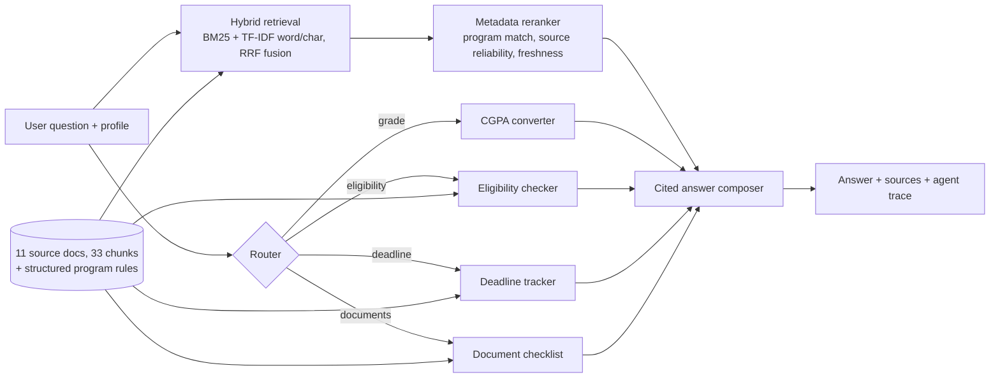

# 🎓 Germany Program Advisor

A RAG + agent system that answers questions about master's programs in Germany (AI/ML, CS, Data Science) from official university pages, with **cited answers**, an **eligibility checker**, a **CGPA to German grade converter**, a **deadline tracker** and a **document checklist**.

Built for international applicants. It is deliberately honest about uncertainty: every source is tagged official / DAAD mirror / aggregator, conflicting sources are flagged, and superseded page versions are demoted.

## Architecture



**Design choices worth knowing**
- **Section-aware chunking** with metadata (university, program, doc type, source type, status, scrape date).
- **Hybrid retrieval**: BM25 and TF-IDF (word + char n-grams) fused with Reciprocal Rank Fusion. An optional dense retriever (`sentence-transformers`) plugs in via `Advisor(use_dense=True)`.
- **Metadata-aware reranking**: boosts the program/university named in the question, mildly prefers official sources, and demotes `status: superseded` pages unless the user asks about an older version.
- **Deterministic tools** for anything numeric (grades, deadlines, eligibility) so results are reproducible and each check cites its source document.
- **Extractive answers by default** (faithful by construction, no hallucination, runs offline). Optional Claude generation with `--llm` and `ANTHROPIC_API_KEY`.
- **Refuses out-of-scope questions** instead of guessing.

## Data

11 documents, 33 chunks, snapshotted on 2026-10-14. Full list with URLs in `data/sources.csv`.

| University | Program | Source type |
|---|---|---|
| TU Munich | MSc Informatics | official (cit.tum.de) |
| TU Munich | MSc Information Systems | official (cit.tum.de) |
| TU Munich | Application guide for Indian students | aggregator (flagged unverified) |
| RWTH Aachen | MSc Software Systems Engineering | official (department page) |
| RWTH Aachen | MSc Computer Science | DAAD database mirror |
| RWTH Aachen | MSc Media Informatics | aggregator (flagged) |
| Saarland University | MSc Data Science and AI | DAAD mirror + listings (deadlines conflict, flagged) |
| University of Tübingen | MSc Machine Learning (2026 requirements, program page) | official |
| University of Tübingen | Older cached requirements page | official, marked `superseded` (2.3 grade threshold vs 2.0 now) |
| General | Grade conversion reference | reference note |

Sources disagree in places (Saarland winter vs summer deadline, Tübingen grade threshold across page versions, Tübingen "restricted" vs "not restricted"). The system surfaces the conflict instead of silently picking one.

## Results

Retrieval evaluation on 30 hand-written questions (`eval/questions.json`). A hit means a top-k chunk comes from the expected document **and** contains the evidence string.

| Method | Hit@1 | Hit@3 | Hit@5 | MRR |
|---|---|---|---|---|
| BM25 | 0.60 | 0.97 | 0.97 | 0.78 |
| TF-IDF (word + char) | 0.73 | 1.00 | 1.00 | 0.86 |
| Hybrid (RRF) | 0.63 | 1.00 | 1.00 | 0.81 |
| Hybrid + metadata rerank | 0.70 | 1.00 | 1.00 | 0.85 |

Reproduce: `python -m advisor.eval`

**Read these numbers with care.** The corpus is small (33 chunks) and the questions were written by the author over the same documents, so scores are optimistic and differences between methods are small. TF-IDF is marginally ahead at Hit@1 here. The honest next step is a larger corpus and an independent question set (see roadmap).

A first version of the reranker *hurt* accuracy: RRF scores are nearly flat between adjacent ranks, so a 10% source-weight multiplier reshuffled correct answers. Source reliability now acts only as a tie-breaker. This is a real failure that was found by the evaluation and fixed.

## Run it

```bash
pip install -r requirements.txt

python -m advisor.cli "Am I eligible for the Tuebingen machine learning master?" --cgpa 8.4
python -m advisor.cli --eval                       # retrieval evaluation
python -m unittest discover -s tests -v            # 15 tests

streamlit run app/streamlit_app.py                 # demo UI
uvicorn api.main:app --reload                      # REST API (/ask, /eligibility/{id}, /deadlines/{id})
```

Deploy the demo free on Hugging Face Spaces (Streamlit SDK): push this repo and set `app_file: app/streamlit_app.py`.

## Limitations (read before relying on it)
- Covers 4 universities and 9 programs. It is a demo, not an admissions authority. Always verify on the official page.
- Several facts come from DAAD mirrors or aggregators and are tagged as such. Official RWTH CS and Saarland pages were not captured in full.
- Deadlines are month and day from the source page. The year assumes the same annual pattern; confirm when the new cycle opens.
- The CGPA to German grade conversion is an estimate (modified Bavarian formula, two methods). The university or uni-assist decides the official grade.
- Tested in this build: ingestion, retrieval, tools, agent, evaluation (15 unit tests pass). Only syntax-checked, not run, in the build environment (no network): the Streamlit UI, FastAPI app, and the optional LLM and dense-retrieval paths.

## Roadmap
1. Grow the corpus to 15 universities and 1,000+ chunks with an automated, scheduled scraper plus change detection.
2. Add dense embeddings (`bge-m3`) and a cross-encoder reranker; measure the gain.
3. Evaluate generation with RAGAS (faithfulness, context precision) on an independent question set.
4. Port the router to LangGraph with LLM tool-calling and conversation memory.
5. Deploy on Hugging Face Spaces and add LangSmith tracing.

## Repo layout
```
advisor/   ingest, retrieval, tools, compose, agent, llm (optional), eval, cli
data/      raw/ (source docs with front matter), programs.json (structured rules), sources.csv
app/       Streamlit UI        api/  FastAPI backend
eval/      questions.json, results.md, results.json        tests/  unit tests
```
